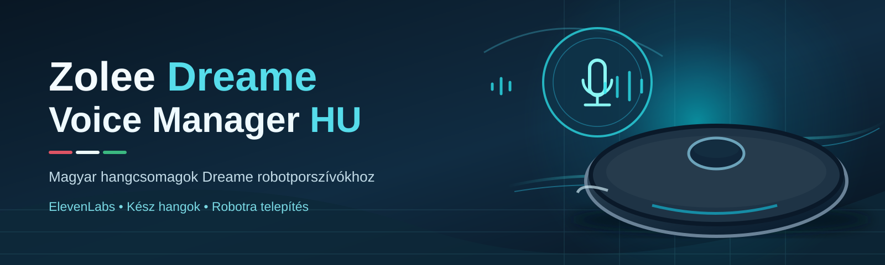

<h1 align="center"></h1>

 

## Előre elkészített magyar hangcsomagok minden új Release-ben

A kész Elison-hangok **589 magyar bemondást** tartalmaznak. **Nem kell hozzá ElevenLabs API-kulcs vagy kredit.** Egyszer töltsd fel a két bináris fájlt a `voicepacks/assets/` mappába (GitHub **Add file → Upload files**), ezt követően az automatizált Release minden új verzióhoz csatolja őket.

- **`Zolee_Dreame_HU_Elison_589_OGG.zip`** — ajánlott, modellhez igazítható, gyári hangoktól mentes 589 magyar OGG.
- **`Zolee_Dreame_X50_HU_Elison_Ready.tar.gz`** — X50 Ultra Complete modellhez teljes, 611 hangos csomag; gyári eredeti hangokat is tartalmaz, ezért csak privát körben terjeszthető a jogok tisztázásáig.

Az Actions pipeline az ellenőrzőösszeget és a teljes archívumtartalmat validálja, csak azután hozza létre vagy frissíti a Release-assets listáját. **Ha a fájlok nincsenek a repóban, a Release szándékosan meghiúsul**, nehogy hiányos letöltést kínáljon. Az első, egyszeri feltöltés után nincs több kézi Release-csatolás.

[**Részletes hangcsomag-telepítési útmutató**](voicepacks/README.md) · [**Egyszeri feltöltés helye**](voicepacks/assets/README.md) · [**Releases**](https://github.com/ZoleeBB/ZoleeDreameVoiceManager-HU/releases)

## 🎙️ Kész magyar robot-hangcsomag – ElevenLabs-kulcs nélkül

**A már elkészült magyar hangok letölthetők és felhasználhatók új hanggenerálás nélkül!**
A Dreame Voice Managerben a **Kész hangok** oldalról nyisd meg a **Kész magyar hang letöltése** lehetőséget, vagy menj közvetlenül a [GitHub Release-hez](https://github.com/ZoleeBB/ZoleeDreameVoiceManager-HU/releases/tag/v1.4.0-hu.8).

**Az előre elkészített hangcsomag használata:**

1. A Release **Assets** részéből töltsd le a `Zolee_Dreame_HU_Elison_589_OGG.zip` fájlt. **Ne csomagold ki!** Ha a ZIP nincs még az Assets között, a feltöltése még hátravan.
2. A programban jelentkezz be a Dreamehome-fiókba, és töltsd le a robothoz tartozó eredeti hangcsomagot a **Start** oldalon.
3. A **Hangfelvételek importálása** oldalon importáld a ZIP-et. A program helyben készít robot-kompatibilis csomagot, az eredeti hangok meghagyásával.
4. A **Kész hangok** oldalon hallgasd meg, majd telepítsd a magyar hangot a robotra.

**Nem szükséges ElevenLabs-előfizetés vagy API-kulcs; a telepítés nem használ fel TTS-kreditet.** A felvételek már elkészültek, az importálás helyben végzett hangátalakítás.

**Jelenlegi lefedettség:** 589 külön magyar bemondás a Dreame X50 Ultra Complete 611 gyári hangjából (96,4%). A fennmaradó 22 hang eredeti nyelven marad. A kipróbált modell az **X50 Ultra Complete**; más robotnál a modellhez igazított ZIP-importot használd, működése a készülék hangtámogatásától függ.

[**Részletes útmutató, SHA-256 ellenőrzés és modellkompatibilitás**](voicepacks/README.md) · [**Hangcsomag manifest**](voicepacks/elison-20261031.json)

> A repó jelenleg privát. A letöltéshez GitHub-hozzáférés szükséges. A kész ZIP Release-be történő feltöltése külön lépés; a README nem állítja, hogy már megjelent, amíg az Assets alatt ténylegesen nem látható.

---

**Alap:** [Anon365-Project/dreame-sprachpaket-manager](https://github.com/Anon365-Project/dreame-sprachpaket-manager), **v1.4.0**. Az eredeti forrás MIT-licenc alatt áll. Az eredeti LICENSE és szerzői információk változatlanul megmaradnak. Az eredeti német hanganyagok ettől független, saját felhasználási feltételek alá esnek; a saját HU build nem csomagolja őket.

## Végleges magyar alapszövegek (v1.4.0-hu.8)

A programba bekerült a felhasználó 2026. október 31-én átadott, kézzel szerkesztett `magyar_vicces_vegleges.json` állományának **mind a 589 magyar szövege**. A `dreamevoice/hu_preset.py` `TEXTS` szótára a teljes, jóváhagyott szövegkészletet tartalmazza, ID és szöveg szerint 1:1-ben; a korábbi 181 bemondásos kezdő csomag megszűnt alapértelmezettnek lenni. A Dreame X50 Ultra Complete eredeti hangcsomagjának 611 fájljából így 589 ID kapott magyar szöveget (**96,4%**); 22, még be nem azonosított hang változatlanul gyári hang marad. Az 589 szöveghez az Elison hanggal **külön előre elkészített OGG ZIP** is rendelkezésre áll, amelyet a felhasználó TTS-generálás nélkül importálhat; az EXE fájlba azonban nem ágyazunk be hanganyagokat.

**Meglévő felhasználói beállítások megőrzése:** az `install_if_missing()` csak az első indításkor hoz létre helyi saját szövegcsomagot. Ha a `magyar_vicces` csomag már létezik az `Eigene Pakete` könyvtárban, a Release nem írja felül a helyi fájlt és a `config.json` egyedi szövegmódosításait. Az alapcsomag megváltoztatása nem írja felül és nem generálja újra a felhasználó korábban elkészített ElevenLabs-hangjait. Új telepítéskor automatikusan az 589 szöveges kezdő csomag jelenik meg.

**Szöveghűség:** a `tests/test_hu_preset.py` a teljes 589 bejegyzés SHA-256 ellenőrzőösszegét és a korábbi személyre szabott mondatokat is ellenőrzi. A felhasználó által írt szövegeket (szleng, humor, helyesírás) nem módosítjuk automatikusan.

## Támogatott Dreame / MOVA / Trouver robotok

A program **nem egy rögzített modellnévlistával** dolgozik: minden belépéskor lekérdezi a kiválasztott robot **hivatalos Dreame hangcsomag-katalógusát**, és az adott modell eredeti hangcsomagjából készít módosított változatot. Ezért **az összes olyan Dreame, MOVA és Trouver modell támogatott, amelynél a Dreamehome alkalmazásban működik a nyelvi hangcsomag kiválasztása és a robot támogatja annak telepítését**.

A rögzített upstream **v1.4.0** kompatibilitási felmérése **714 azonosító** közül **402 modellazonosítóhoz** talált hangcsomag-katalógust:

| Márka | Hangcsomag-katalógussal rendelkező modellazonosítók |
| --- | ---: |
| Dreame | **288** |
| MOVA | **97** |
| Trouver | **17** |
| **Összesen** | **402** |

A további 312 vizsgált modellhez nem volt katalógus (például korábbi Mi Home-os készülékek). A gyakorlatban az összes támogatott modell **aktuális listáját a hivatalos szolgáltatás határozza meg**; a 402 az upstream akkori felmérése, nem garantált, naprakész, 402 terméknevet tartalmazó lista.

Az upstream ellenőrzött kompatibilitási mintái (a modellkód a gyári belső azonosító):

- Dreame: `dreame.vacuum.r2532h`, `dreame.vacuum.r501wj`, `dreame.vacuum.r63018`, `dreame.vacuum.r9535e`, `dreame.vacuum.r2253a`.
- MOVA: `mova.vacuum.r5769t`, `mova.vacuum.r5977e`, `mova.vacuum.r6710a`.
- **Helyben kipróbált készülék:** Dreame **X50 Ultra Complete**.

**Más modellnél** a modellfüggetlen, **589 OGG-hangot tartalmazó ZIP-et** importáld, ne az X50 gyári vezérlőadatait is tartalmazó `.tar.gz` csomagot. A program az eltérő hangazonosítókat és gyári metaadatokat a saját robothoz igazítja, de a tényleges telepítés sikerét mindig ellenőrizni kell.

Forrás: [az upstream részletes modellkompatibilitási dokumentációja](https://github.com/Anon365-Project/dreame-sprachpaket-manager/blob/v1.4.0/docs/Modelle.md).

## Jelenlegi felépítés és CI/CD

A privát repóban csak a **magyar kiegészítés (overlay)** van. A fordító workflow a GitHubról klónozza az eredeti program pontosan rögzített `v1.4.0` kiadását (`852f3043727fc85a3c06cb54231a00de013b1492`), majd a `scripts/apply_overlay.py` módosításait és a **saját szövegeidet** (`dreamevoice/hu_preset.py`) alkalmazza.

Ez szándékos: az upstream forrás nem kell még egyszer a repóba, és a magyar szövegeket a build sosem írja felül.

**Teendők:**
1. Merge előtt a PR-nél ellenőrizd a `Dreame HU - Windows Build` eredményét.
2. A sikeres build `DreameVoiceManager-HU` artifactja 7 napig tölthető le.
3. A PR sikeres ellenőrzését követően a `main`-be merge-elt `VERSION-HU` fájl automatikusan elindítja az első Release workflow-t (`v1.4.0-hu.1`). A build tesztel, majd a Releases felületre feltölti az EXE-t és az ellenőrzőösszeget. Későbbi kiadáshoz módosítsd a `VERSION-HU` értékét, és egyesítsd a `main`-be; szükség esetén a workflow kézzel is indítható.
4. A Windows EXE nem aláírt. Indítás után ellenőrizd a magyar TTS-hangot és hallgasd meg az egyes bemondásokat a robotra telepítés előtt.

**CI megjegyzés:** az upstream `selftest.py` minden tesztjét lefuttatjuk, de a GitHub runnerén hiányzó, külön kiadott hat német hangarchívumhoz és az AMSI környezetéhez kapcsolódó, név szerint felsorolt 12 eltérés nem blokkolja a buildet. Bármely egyéb sikertelen upstream teszt hibának számít. A magyar regressziós tesztek mindig kötelezőek.

**Helyi fordítás:** PowerShellben futtasd a `./scripts/prepare-source.ps1` scriptet a repó gyökeréből, utána `cd _upstream-src`, majd `./scripts/build-release.ps1`. Az eredmény: `_upstream-src/dist/DreameSprachpaket-HU.exe`.

A régi `setup-private-repo.ps1` csak egy **új, üres** repository egyszeri létrehozására készült; **itt már nem kell futtatni**.

## Fordítás és kiadás

- CI: `.github/workflows/build.yml` — `main`, `develop`, PR és kézi indítás.
- Release: `.github/workflows/release.yml` — `v*` tageknél létrehozza a release-t, feltölti az EXE-t és a SHA-256 ellenőrzőösszeget.
- Python 3.12, `windows-2022`, PyInstaller és requests verzió pinelve a `requirements-hu-build.txt` fájlban.
- FFmpeg letöltés csak előzetesen rögzített SHA-256 ellenőrzéssel történik. A BtbN `latest` hivatkozása időközben megváltozhat: ebben az esetben a build biztonságosan leáll, és kézi ellenőrzés/új SHA szükséges a `scripts/build-release.ps1` fájlban.
- A magyar EXE neve `DreameSprachpaket-HU.exe`. Ez a saját build nem frissíti magát az eredeti projekt aláíratlan EXE-jére. A frissítések a saját GitHub Releases felületről tölthetők le.
- Nem használ GitHub secretet a Dreame-bejelentkezéshez; a jelszó csak helyben, az alkalmazásba kerülhet.

## ElevenLabs hibatűrő generálás (v1.4.0-hu.5)

A hosszú magyar TTS-futtatásoknál az ElevenLabs a HTTP **429** állapotkóddal jelezheti, hogy túl sok párhuzamos kérés érkezett, vagy az API átmenetileg túlterhelt. Ez **nem azonos** a felhasználható kreditkeret elfogyásával. A magyar változat legfeljebb **2 párhuzamos TTS-kérést** indít (a Free és Starter csomagok alatt is biztonságos tartalékkal), és korlátozott számú exponenciális visszavárakozással próbálkozik újra. A HTTP 500/502/503/504 hibák szintén újrapróbálhatók, a valóban elégtelen kreditet (402) külön kezeli.

Ha egy futás részleges csomagot készít, a már legenerált `.mp3` állományokat a program megtartja. **A pontosan ugyanazzal a hanggal, modellel és beállításokkal** újraindított generálás csak a hiányzó bemondásokhoz fordul az API-hoz. A felhasználó által módosított `hu_preset.py` mondatok változatlanok maradnak. A teljes hangcsomag előtt a készültséget az eredeti magyar csomag 181 bemondásához kell mérni, nem a gyári eredeti 611 fájljához.

## Teljes magyar hangcsomag – hiányzó bemondások fordítása (v1.4.0-hu.7)

Az X50 Ultra gyári hangcsomagja körülbelül 611 felvételt tartalmaz, a kezdeti vicces magyar készlet 183 bemondást tartalmazott. A különbség **nem ElevenLabs TTS-probléma**: a hiányzó hangazonosítókhoz még nincs magyar szöveg.

A **Hangcsomag készítése → Magyar – Vicces házimunkás** oldalon két új gomb:

1. **Hiányzó magyar hangok exportálása** – a robotból letöltött gyári csomag *valódi hangazonosítóit* ellenőrzi, és csak a magyarul még hiányzó sorokból készít UTF-8 szövegfájlt a **Dialekttexte** mappába. A fájl elején részletes, biztonságtudatos fordítási prompt van. A sorok formátuma: `azonosító | eredeti jelentés / DE+EN | magyar TTS-szöveg`.
2. A fájlt átadhatod egy nyelvi modellnek fordításra, majd lektorálhatod. A roboton ismeretlen, címke nélküli hangokat *nem szabad kitalálni*: eredeti hangminta alapján kell beazonosítani és kitölteni. A fordítás csak a harmadik oszlopba kerülhet.
3. **Magyar fordítások importálása** – kizárólag új, a gyári csomagban létező, hiányzó azonosítókat vesz át a meglévő `magyar_vicces` felhasználói szövegcsomagba. Nem írja felül a korábban szerkesztett mondatokat, nem törli az ElevenLabs-felvételeket, és a helykitöltőket kihagyja. Duplikált azonosítókat elutasít.
4. Ezután ugyanazzal a hanggal és modellbeállításokkal a **Hangcsomag létrehozása** műveletet újból elindítva a program csak az új/hiányzó mondatokat generálja, a meglévők változatlanul megmaradnak. A kész csomagot telepítés előtt meg kell hallgatni.

A fordítási prompt önmagában **nem fordít automatikusan**, és nem küld adatot külső AI-szolgáltatásnak. A katalógus német és angol megnevezései tájékoztató jellegűek, a hangfelvételek elsődlegesek. A teljes magyar lefedettség csak akkor jelenthető ki, ha a *ténylegesen rendelkezésre álló* gyári felvételek összes azonosítója magyar szöveget kapott és minden szöveghez új hangfájl készült.

## Magyar hangcsomag

Első indításkor a program létrehozza a `Magyar – Vicces házimunkás` szerkeszthető **saját** hangcsomagot. Az ismert takarítási és hibaüzenetekhez vannak magyar mondatok, és a százalékos akkumulátorbemondásokat, helyiségneveket is magyarul készíti elő. **Nem teljes fordítás**: a még le nem fedett azonosítók az eredeti gyári hangon maradnak, így nem tűnnek el fontos figyelmeztetések.

A kezelőfelületen a `Dialekt erzeugen` (Dialekt előállítása) résznél az `Eigenes · Magyar – Vicces házimunkás` elemet válaszd. A Windows-hangok között ez a változat már német **és magyar** hangokat is felsorol. Ha nincs `hu-HU` hang, Windows **Settings → Time & language → Language & region → Hungarian → Language options → Text-to-speech** résznél add hozzá, ha elérhető. A lista telepített hangoktól függ; előbb hallgasd meg a próbát, és csak utána generáld a csomagot. A kötelező eredeti Dreame hangcsomagot a program letölti a gyári forrásból.

**A magyar felület fejlesztése folyamatban van.** Egyes magyartalan és német szövegek még előfordulhatnak; javításuk külön fejlesztés. A magyar hangsáv is Windows magyar TTS-hangot igényel; ElevenLabs esetén külön fiók/kulcs és szolgáltatási díj merülhet fel.

## ElevenLabs – magyar beszédgenerálás

A HU-változat az ElevenLabs `eleven_flash_v2_5` modelljét választja alapértelmezettként. A `eleven_multilingual_v2` nem támogatja a magyar nyelvet. A magyar `magyar_vicces` hangcsomag szerkesztésekor a modellválasztó kizárólag a magyarul ellenőrzött `eleven_flash_v2_5` és `eleven_turbo_v2_5` modelleket mutatja. A Flash 2.5 az ajánlott; a Turbo 2.5 régebbi alternatíva.

Az ElevenLabs API-kulcsot a helyben futó programba kell beírni: `Dialekt erzeugen` → `ElevenLabs` → `Verbinden und Stimmen laden`. A kulcsot **nem** kell GitHub Secretsbe tenni, és nem kerül a CI buildbe. Magyar kiejtésű hangot válassz, majd 1–3 próbamondattal teszteld. A hiányzó bemondásokat a program később folytathatóan generálja. Az ElevenLabs kapcsolatra csak generáláskor van szükség, a robotra kész hangfájlok kerülnek.

Az API kulcshoz az ElevenLabs fiókban engedélyezd a Text to Speech és a szükséges Voices / Models / User olvasási hozzáférést; állíts be használati limitet. A kulcsot ne írd dokumentációba, kódba vagy GitHubra.

## Biztonsági és működési korlátok

- A saját build nem bizonyítja a kártevőmentességet; a források, az FFmpeg és a CI-függőségek ellenőrzése továbbra is szükséges.
- A CI build minden induláskor harmadik féltől származó Python-csomagokat telepít a PyPI-ról. A közvetlen verziók rögzítettek, a tranzitív függőségek még nincsenek teljes hash-lockkal lezárva.
- A Microsoft Defender SmartScreen figyelmeztethet a nem digitálisan aláírt saját EXE-re.
- A robot hangcsomag-telepítése gyári funkcióra épül, de nem hivatalosan támogatott. Nem módosítja a firmware-t, ám az X50 modellen való működés helyszíni ellenőrzése szükséges.
- A CI eredményét a GitHub Actions futási naplója igazolja; a Windows TTS tényleges hangminőségét és a roboton való működést külön ellenőrizni kell. A kezdeti projektfájlok szerkezetét és Python-szintaxisát helyben ellenőriztük, a Windows TTS-t és az FFmpeg-es EXE-t itt nem tudtuk végigtesztelni.

## Saját változat frissítése

Az `upstream` remote az eredeti publikus projekt. Új upstream kiadást előbb ellenőrzött fejlesztői branchbe hozz be, futtasd a teszteket, és PR-rel egyesítsd. A saját magyar presetet nem írjuk felül az újraindításkor: ha egyszer már létrejött és szerkesztetted, változatlan marad.

